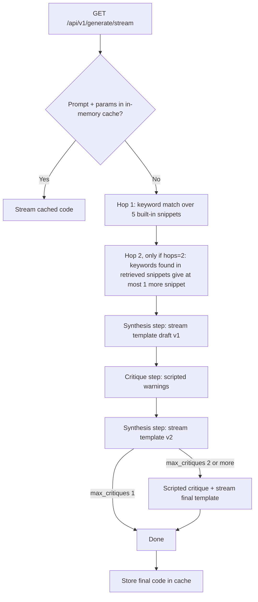

# AgentCodex: Multi-Agent Code Generation Prototype (Simulated Agents)

AgentCodex is a prototype UI and backend for a synthesis-and-critique coding agent workflow. A FastAPI endpoint streams each step of the workflow (two-hop retrieval, draft, critique, refinement) to the browser over **Server-Sent Events (SSE)**, and repeated requests are answered from an **in-memory cache**.

**Status: prototype / demo. No LLM is called.** The "agents" are scripted: the synthesis and critique steps emit pre-written log messages with fixed `asyncio.sleep` delays, and the code shown is one of two hard-coded template sets (a FastAPI + Redis rate limiter if the prompt contains `redis` or `limiter`, otherwise a generic Python script). Retrieval is keyword matching over five built-in documentation snippets. The project demonstrates the streaming, orchestration and caching plumbing that a real LLM agent would plug into.

The user interface is a black-and-gold IDE-style layout showing the agent log stream side by side with the streamed code viewer.

## Live Demo

https://multi-agent-llm-code-generator.onrender.com (Render free tier: the first request after a period of inactivity can take up to a minute or return HTTP 503 while the service wakes up).

---

## 🏗️ System Flow & Architecture



The template is chosen from the prompt text only; the retrieved context is shown in the log stream but is not used to build the code, and the `temperature` parameter only changes the cache key.

### 1. Multi-Hop Retrieval (`app/services/rag.py`)
- **Knowledge base**: five hard-coded snippets (FastAPI lifespan, async Redis pool, Redis sliding-window rate limiter, Pydantic schemas, SSE streaming), each with a keyword list.
- **Hop 1 (direct retrieval)**: tokenises the prompt and returns up to two snippets ranked by keyword overlap.
- **Hop 2 (expansion)**: looks for other snippets' keywords inside the retrieved snippet text, runs a second keyword search, and adds at most one more snippet.
- There are no embeddings, vector index or TF-IDF scoring.

### 2. Simulated Critique Loop (`app/services/agents.py`)
- **Synthesis step**: streams a pre-written draft (v1) in five chunks.
- **Critique step**: emits fixed warnings (missing type annotations, missing exception handling), then the synthesis step streams a refined template (v2). With `max_critiques >= 2`, a second scripted critique is followed by the final template.
- No code is analysed, linted or executed; the critique messages are the same for every prompt.

### 3. Caching (`app/main.py`)
- Key: SHA-256 of `prompt (lower-cased, trimmed) : max_critiques : hops : temperature`.
- The final code is stored in a module-level Python dict after a generation completes; a later identical request streams the stored code instead of re-running the steps.
- `GET /api/v1/cache/status` lists cached prompts; `POST /api/v1/cache/clear` empties the cache. The cache is per process, unbounded, has no TTL, and is lost on restart.

### Response times

There is no LLM latency to measure: both paths are dominated by deliberate `asyncio.sleep` calls that pace the UI. A cache hit includes three 0.3 s pauses (about 0.9 s); a cache miss with the default `max_critiques=2` takes about 11–12 s. These are properties of the scripted delays, not a benchmark of real generation.

## 🧪 Verification & Coverage

The test suite (`tests/test_generator.py`, 5 tests) uses `pytest`, `pytest-asyncio` and `httpx` against the ASGI app in-process. It covers the dashboard route, the SSE stream, and the cache miss → hit → status → clear cycle. It checks event format and cache behaviour, not the quality of generated code. Because of the scripted delays, the suite takes about 16 s.

```bash
# Set up virtual environment
py -3.13 -m venv .venv
.venv\Scripts\activate
pip install -r requirements.txt

# Run test suite
pytest --cov=app --cov-report=term-missing tests/
```

### Coverage Report
Reproduced in this audit with Python 3.14.7 (`pytest -p no:cacheprovider --cov=app --cov-report=term-missing tests/`):
```
Name                     Stmts   Miss  Cover   Missing
------------------------------------------------------
app\main.py                 76      2    97%   109-110
app\services\agents.py      61     16    74%   216-236
app\services\rag.py         54      1    98%   146
------------------------------------------------------
TOTAL                      191     19    90%
============================= 5 passed in 16.42s ==============================
```

---

## ⚙️ Running Locally

Run the container:
```bash
docker-compose up --build
```
Or without Docker (after `pip install -r requirements.txt`):
```bash
uvicorn app.main:app --reload --port 8000
```
Once started, visit `http://localhost:8000` in your web browser. No API keys or environment variables are required.

---

## 🚀 Deploy to Render
This repository contains a `render.yaml` blueprint. To deploy:
1. Create a **New Blueprint** in your Render dashboard.
2. Connect this repository (`multi-agent-llm-code-generator`).
3. Set the branch to **`main`**.
4. Click **Apply**. Render will build and deploy the container.

---

## Limitations and Next Steps

- **No LLM integration** – synthesis and critique are scripted; output is one of two template sets regardless of the request details.
- **Retrieval is keyword matching** over five built-in snippets, and the retrieved context is not used to produce code.
- **No measurement of output quality** – there is no evaluation set, error-rate metric or execution/lint check of generated code.
- **Cache** is an unbounded in-process dict shared by all users (the status endpoint lists every cached prompt), with no TTL or persistence.
- **`temperature`** has no effect beyond the cache key.

Natural next steps: call a real model behind the `MultiAgentOrchestrator.generate` interface, make the critique step run real checks (e.g. `ruff`, `mypy`, or executing generated tests), replace keyword retrieval with embedding search, and add an evaluation set (prompts plus pass/fail checks) so that any error-rate claim can be measured and reproduced.
