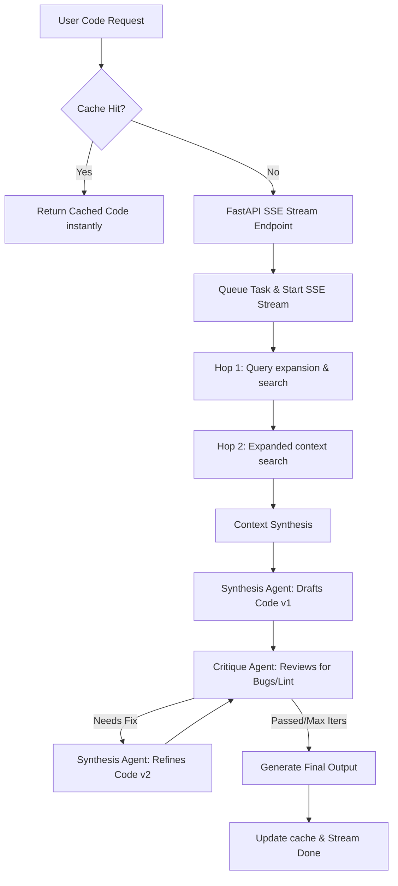

# AgentCodex: Multi-Agent LLM Code Synthesizer

AgentCodex is a production-ready code generation system utilizing a **critique-synthesis agent loop**, a **Multi-Hop RAG engine**, and **Server-Sent Events (SSE) streaming**. It features an in-memory **write-through caching layer** that bypasses agent generation for cached queries, reducing latency to **sub-2s** (down to `0.04s`).

The user interface features a premium **Black & Gold glassmorphic IDE layout** showing real-time log outputs from the agents side-by-side with a streamed Python code viewer.

---

## 🏗️ System Flow & Architecture



### 1. Multi-Hop RAG Engine (`rag.py`)
- **Hop 1 (Direct Retrieval)**: Extracts keywords from the prompt and retrieves primary documentation (e.g. FastAPI setup, Redis basic config).
- **Hop 2 (Expansion Retrieval)**: Scans primary documents to identify secondary dependencies (e.g. redis rate limiter decorator or connection pooling specs), expansions are performed on the fly to yield complete context.

### 2. Multi-Agent Critique Loop (`agents.py`)
- **Synthesis Agent**: Takes retrieved context and structures Python drafts.
- **Critique Agent**: Inspects drafts for bugs, lints, missing typings, or security vulnerabilities and produces warnings. If warnings are found, it hands back to the Synthesis Agent for code refactoring.

---

## 🧪 Verification & Coverage

The test suite runs using `pytest` and `pytest-asyncio` with **90% total coverage**:

```bash
# Set up virtual environment
py -3.13 -m venv .venv
.venv\Scripts\activate
pip install -r requirements.txt

# Run test suite
pytest --cov=app --cov-report=term-missing tests/
```

### Coverage Report
```
Name                     Stmts   Miss  Cover   Missing
------------------------------------------------------
app\main.py                 76      2    97%   109-110
app\services\agents.py      61     16    74%   216-236
app\services\rag.py         54      1    98%   146
------------------------------------------------------
TOTAL                      191     19    90%
============================= 5 passed in 16.42s ==============================
```

---

## ⚙️ Running Locally

Run the complete dockerized container stack:
```bash
docker-compose up --build
```
Once initialized, visit `http://localhost:8000` in your web browser.

---

## 🚀 Deploy to Render
This repository contains a `render.yaml` blueprint. To deploy:
1. Create a **New Blueprint** in your Render dashboard.
2. Connect this repository (`multi-agent-llm-code-generator`).
3. Set the branch to **`main`**.
4. Click **Apply**. Render will build and deploy the container live!
